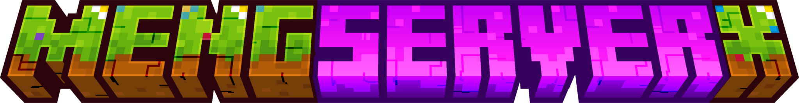

## 📋MengServerX

### 🌏Idiomas soportados:

### 🔍Funcionalidades soportadas:
- [x] Soporte multilingüe
- [x] Modificar formato del chat
- [x] Lista blanca de nombres
- [x] Conservar inventario
- [x] Protección del terreno
- [x] Limpiar objetos tirados
- [x] Tabla de puntuación de excavación
- [x] Chat con AI
- [x] Teletransporte entre jugadores
- [x] Anuncios globales del servidor
- [x] Ayudante de comandos

### 🧩Concepto de diseño:
Este plugin utiliza un diseño modular donde las funciones son independientes entre sí, facilitando el mantenimiento y actualizaciones futuras.

### 📌Notas importantes:
La ***lista blanca*** está activada por defecto. Para desactivarla, modifique el archivo ***config.yml***. Gracias por su comprensión.

### 🔨Cómo compilar:
- Use `git clone https://github.com/HuanMeng-official/MengServerX.git` para clonar el código
- Importe el proyecto en su IDE (se recomienda IDEA)
- Compile el código con Maven
- Obtenga el archivo .jar en la carpeta target

### 💡Colaboradores:
|HuanMeng|Aurora|WanNing|
|:------:|:----:|:-----:|
|https://github.com/HuanMeng-official|https://github.com/Aurora-official|https://github.com/WanNing-official|